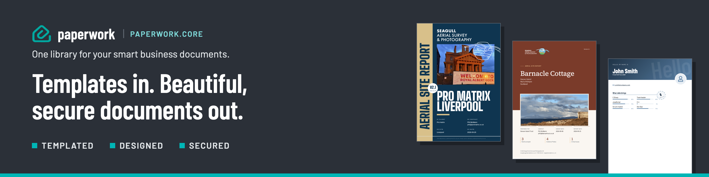

[Scryber](https://www.nuget.org/packages/Scryber.Core) | **Core** | [Git](https://github.com/paperwork-collective/Paperwork.Core) | [CLI](https://www.nuget.org/packages/Paperwork.CLI) | [Skill](https://github.com/paperwork-collective/Paperwork.Skill) | [Design](https://paperwork.design) | [View](https://paperwork.vu) | [Help](https://paperwork.help) | [Corp](https://www.paperwork-collective.com)

# Paperwork.Core

**Templates in. Beautiful, secure documents out.**

Paperwork.Core is for embedding document generation in your .NET applications. Give it a template exported from the Paperwork Designer, your own HTML, or a document or component built in code, add your data and fields, and generate the PDF, through a simple fluent builder. It runs on the open-source [Scryber](https://github.com/richard-scryber/scryber.core) engine, and is the library behind the Paperwork Designer ([paperwork.design](https://paperwork.design)) and Viewer ([paperwork.vu](https://paperwork.vu)).

- **Templated**: HTML and CSS templates, with handlebars binding to your fields and data.
- **Designed**: build and preview templates in the Paperwork Designer, export them, then generate the same document from your code.
- **Secured**: you choose how remote sources are fetched and authorised, and documents can carry passwords and restrictions.

> **Coming from Scryber.Core?** Paperwork.Core uses the same engine, so your templates work unchanged, and Scryber.Core users are encouraged to switch. A `Document` you already build can be passed straight in with `WithLayout(document)`. See [Switching to Paperwork.Core](https://github.com/richard-scryber/scryber.core#switching-to-paperworkcore).

## The Paperwork family

| | What it's for |
|---|---|
| [Scryber.Core](https://www.nuget.org/packages/Scryber.Core) ([git](https://github.com/richard-scryber/scryber.core)) | The open-source generation engine: templates, and code to create a document. |
| **Paperwork.Core** (this package, [git](https://github.com/paperwork-collective/Paperwork.Core)) | Embedding generation in your .NET applications, from your own template or a document built in code. |
| [Paperwork.CLI](https://www.nuget.org/packages/Paperwork.CLI) | Creating dynamic documents from your templates automatically, whether referenced or downloaded. |
| [Paperwork.Skill](https://github.com/paperwork-collective/Paperwork.Skill) | Making the CLI available to your AI, to design, build and run document creation. |
| [Paperwork.Design](https://paperwork.design) | The online template designer: build, preview and publish your templates. |
| [Paperwork.View](https://paperwork.vu) | The free online PDF viewer for your custom templates and Paperwork designs. |
| [Paperwork.Samples](https://github.com/paperwork-collective/Paperwork.Samples) | The designs and templates from the help files at [paperwork.help](https://paperwork.help), ready to use. |

Documentation for all of them is at [paperwork.help](https://paperwork.help).

## Installation

```bash
dotnet add package Paperwork.Core
```

## Quick Start

```csharp
using Paperwork;

using var factory = PaperworkFactory.Create(httpClient).Build();
//using var factory = PaperworkFactory.Create().Build(); - own internal httpClient

var bytes = await factory.NewDocument()
    .WithLayout("<html><body><p data-content='{{$fields.title}}'></p></body></html>")
    .WithField("title", "Hello World")
    .BuildBytesAsync();

await File.WriteAllBytesAsync("output.pdf", bytes);
```

## Usage

### Setup

```csharp
// Minimal — no auth
var factory = PaperworkFactory.Create(httpClient).Build();

// With custom auth
var factory = PaperworkFactory.Create(httpClient)
    .WithAuth(new MyAuthService())
    .Build();

// ASP.NET Core DI - uses the app's HttpClient, tracing and file request services if registered
services.AddPaperwork();

// ...and pass the configuration to the engine, for the "Paperwork" (or "Scryber") appsettings section
services.AddPaperwork(builder.Configuration);

// Without DI - once at startup
PaperworkConfiguration.Init(configuration);
```

The engine options (Fonts, Imaging, Parsing, Output, Tracing...) can be set in a `"Paperwork"` section of the configuration and will be applied (any `"Scryber"` options will also be read, with `"Paperwork"` settings applied on top).

### Layout

```csharp
// Inline HTML string
builder.WithLayout("<html><body>...</body></html>");

// From a file - relative images and stylesheets are found next to the file
builder.WithLayoutFile("invoice.html");

// From a URL (fetched at render time)
builder.WithLayoutUrl("https://cdn.example.com/template.html");

// Pre-built Document - configure it first (Info, RenderOptions, events...), it is generated as it is
builder.WithLayout(document);

// Add custom partials that can be accessed via $layouts["name"]
builder.WithLayout("<p> Injected by {{model.name}}</p>", "innerPartial");
```

### Styles

```csharp
builder.WithStyle("body { font-family: sans-serif; }");
builder.WithStyleFile("styles.css");
builder.WithStyleUrl("https://cdn.example.com/styles.css");
builder.WithStyle(styleGroup);  // Custom StyleGroup
```

### Data

Data entries are designed for large feeds, loaded files and complex object graphs, that can be enumerated over and calculated on.

```csharp
// JSON string — bound as {{name.field}} in templates
builder.WithData("order", "{\"total\": 1200}");

// From a file
builder.WithDataFile("order", "order.json");

// Any object — set directly on doc.Params
builder.WithData("order", new { total = 1200 });
```
And then used directly in the templates, or stylesheets - with over 100 functions and expressions (including custom functions).

Loops and inner properties:

```html
{{#each order.items}}
    <div class="item" >{{format(this.price, "£#0.00")}}</div>
{{/each}}
```

Variables and calculations:

```html
<var data-id="subtotal" data-value="{{sumOf(order.items,this.price)}}" />
```

Output and formatting:

```html
<div class="sub" >Subtotal: {{format(subtotal, "£#0.00")}}</div>
<div class="total" >Total: {{format(order.total, "£#0.00")}}</div>
```

### Fields

Fields are simple values accessible in templates as `$fields["key"]` or `$fields.key` and can be used anywhere in the template(s) or stylesheet(s):

```csharp
builder.WithField("date", "2026-03-25");
builder.WithField("theme", "blue");
```

Used directly in the style or content:

```html
<p style="color: {{$fields.theme}}" >{{$fields.date}}</p>
```

```css
/* declared in stylesheets or style blocks */
body{
    --theme: var($fields.theme, '#000');
}

p {
    color: var(--theme);
}
```

`WithField(id, value, type)` only accepts a **scalar** `string` value. A field whose value is a nested object or array (e.g. a Designer-authored `single`/`list`-type field) can't be built up this way — load it via `FromConfig`/`FromDefinition` instead (below), which preserves nested values as `JsonElement`.

### Loading a full template config

```csharp
// From a stream/file — deserializes straight into TemplateDefinitionV1,
// preserving any nested field values as JsonElement rather than flattening them
using var stream = File.OpenRead("template-config.json");
var builder = factory.FromConfig(stream);

var bytes = await builder.BuildBytesAsync();
```

The JSON is the same `{"schemaVers": "1.1", "template": {...}}` shape a published Paperwork template is stored as — see [Paperwork.CLI's config-format docs](https://paperwork.help/paperwork.cli/config-format.html) for the full schema, including nested field values.

### Generate

```csharp
// As bytes
byte[] pdf = await builder.BuildBytesAsync();

// Save to file
await builder.SaveAsync("output.pdf");

// Write to a stream, e.g. a response body
await builder.SaveAsync(stream);

// Full result with metadata
PaperworkResult result = await builder.BuildAsync();
```

### Logging

```csharp
// Append the trace log to the end of the document
builder.WithLogLevel(PaperworkRequestLogOption.Messages);
```

The default, `PaperworkRequestLogOption.Template`, uses the template's own `<?paperwork append-log='true' ?>` setting. `Off` turns the log off, whatever the template says.

### Security

A template can carry a `security` section, saved by the Paperwork Designer, or you can set it in code:

```csharp
using Paperwork.Generation.v1;

// What the reader may still do - anything left out is restricted:
// printing, copying, annotations, forms, modifications, accessibility
builder.WithSecurity(new TemplateSecurity { Allow = { "printing", "accessibility" } });

// A password needed to open the document
builder.WithUserPassword("open-sesame");
```

The owner password is a new random value for each document, never stored or shown, so the restrictions cannot be lifted. The open password is never logged. A template that requires an open password fails with code -401 when none is given. Security set this way replaces any `print-restrictions` meta tag in the template.

## Related packages

- [`Paperwork.Core.Extensions`](https://www.nuget.org/packages/Paperwork.Core.Extensions) — shared portal config, `$assets`/`$maps` remote-file resolution, and cross-platform auth handlers (Atlassian, Firebase Asset) for consumers that need them. Not a dependency of this package — install it separately if you need that functionality.
- [`Paperwork.CLI`](https://www.nuget.org/packages/Paperwork.CLI) — command-line PDF generation built on this package.

See [paperwork.help](https://paperwork.help) for more information on the full family of paperwork solutions.

## License

MIT
